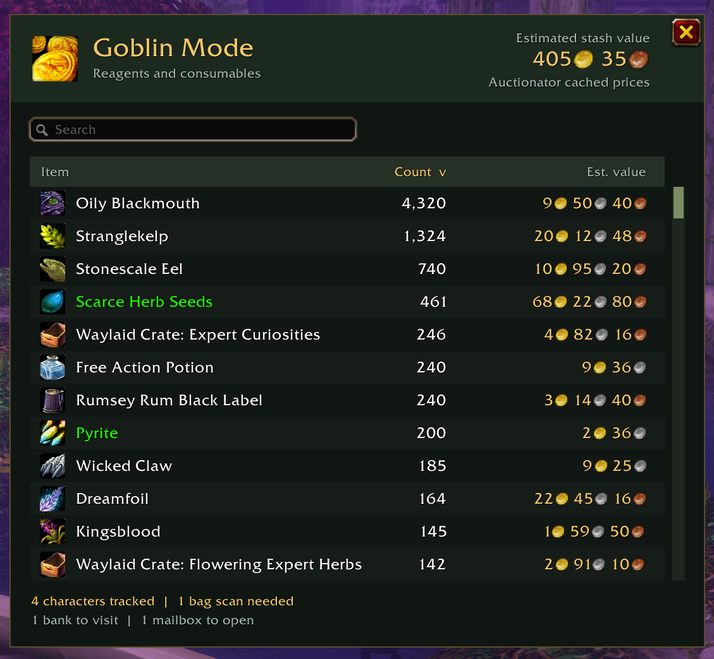

# Goblin Mode

Goblin Mode is a World of Warcraft: Forever addon that totals crafting reagents and consumables across your characters' bags, personal banks, and mailboxes. The searchable list shows how many you have and what they're worth. Hover over an item to see who has it and where. Soulbound copies are excluded.

The **Estimated stash value** combines tracked item values with your characters' carried gold, silver, and copper. **Carried money** shows the currency subtotal beside it. Item values use Auctionator's cached auction prices when available and the game's vendor sell price otherwise. Auctionator is optional.

Hover over the **character count** in the footer to see which characters have been scanned and which still need a bag, bank, or mail scan. The tooltip also flags incomplete mail scans and missing gold balances.

## Install and use

1. Copy the `GoblinMode` folder into `_forever_/Interface/AddOns/` and restart the game if it's open.
2. Click the coin on the minimap or type `/goblinmode` to open the window.
3. Log into each character to record their bags and carried money, then open their bank and mailbox to scan those locations. Goblin Mode keeps the last scan and balance for offline characters.
